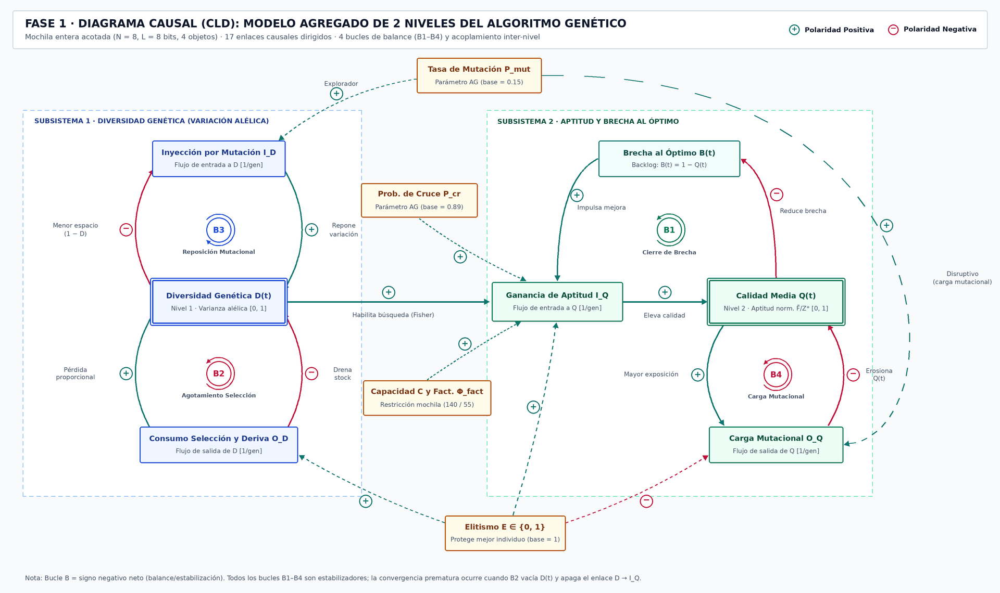
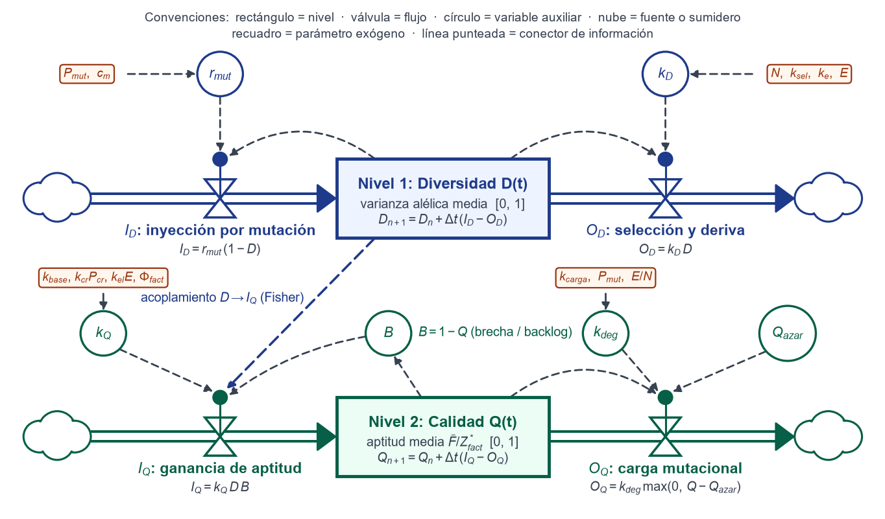

# Modelado de un Algoritmo Genético mediante Dinámica de Sistemas

**Autores:** Felipe Grisales López · Andrés Hernández  
**Asignatura:** Dinámica de Sistemas — Universidad Nacional de Colombia (2026)  
**Enfoque:** Modelo dinámico agregado de dos niveles —Diversidad genética $D(t)$ y Calidad media normalizada $Q(t)$— aplicado al Algoritmo Genético del problema de la mochila entera acotada ($N = 8$ individuos, $L = 8$ bits, 4 objetos).

---

## 📌 Evidencias Principales de la Entrega

| Entregable | Archivo | Descripción |
|---|---|---|
| **1. Modelo en Excel (DS + AG)** | [`Modelo_AG_Dinamica_de_Sistemas.xlsx`](./Modelo_AG_Dinamica_de_Sistemas.xlsx) | Libro con **8 hojas**, **8,856 fórmulas nativas** y **7 gráficas**: frontera del sistema y ecuaciones DS, parámetros y enumeración exacta de $\{0,1\}^8$, réplica paso a paso del AG (Gen 0–5), integración numérica por Euler ($\Delta t = 1$ y $\Delta t = 0.5$ gen), calibración frente a 500 réplicas Monte Carlo, validación ($\text{RMSE} \le 0.0440 \le 0.05$ en 8/8 escenarios) y pruebas estadísticas ($\alpha = 0.05$: Wilcoxon, Kruskal-Wallis, Mann-Whitney y ANOVA trifactorial). |
| **2. Informe Final (PDF)** | [`Informe_Final_Proyecto_Dinamica.pdf`](./Informe_Final_Proyecto_Dinamica.pdf) | Documento final de **42 páginas** en formato institucional ASI: planteamiento, desarrollo completo de las Fases 1 a 8, 22 tablas, 4 figuras, contraste de hipótesis, conclusiones y **Anexo A (Bitácora de uso de IA)**. |
| **Informe Editable (Word)** | [`Informe_Final_Proyecto_Dinamica.docx`](./Informe_Final_Proyecto_Dinamica.docx) | Versión editable del informe final con ecuaciones nativas OMML sobre la plantilla institucional ASI. |

---

## 📂 Estructura de la Carpeta

Siguiendo la organización establecida en el repositorio del curso (`proyectos/<estudiantes>/proyecto_1/`):

```text
proyecto_1/
├── README.md                                  # Resumen e índice de evidencias
├── Modelo_AG_Dinamica_de_Sistemas.xlsx        # Modelo completo de simulación en Excel
├── Informe_Final_Proyecto_Dinamica.pdf        # Informe final formato ASI (PDF)
├── Informe_Final_Proyecto_Dinamica.docx       # Informe final formato ASI (Word editable)
├── diagramas/                                 # Diagramas causales, de Forrester y modos de referencia
│   ├── diagrama_causal_cld.png
│   ├── diagrama_causal_cld.svg
│   ├── diagrama_forrester.png
│   ├── modos_referencia_ag.png
│   └── arquitectura_subsistemas.png
├── scripts/                                   # Réplica en Python (Fase 3) y generación reproducible
│   ├── generar_modelo_excel.py
│   ├── diagrama_forrester.py
│   ├── generar_graficos_fase1.py
│   ├── generar_informe_word.py
│   ├── informe_docx.py
│   └── requirements.txt
└── anexos/                                    # Compendio matemático en LaTeX y bitácora de IA
    ├── Formulas_y_Desarrollo_Matematico.tex
    ├── Ecuacion_de_Trayectoria.tex
    └── Bitacora_IA_Proyecto_Dinamica.md
```

---

## 🔄 Vista Rápida de los Diagramas del Modelo

### Diagrama Causal (CLD)


### Diagrama de Forrester (Modelo Agregado de 2 Niveles)

